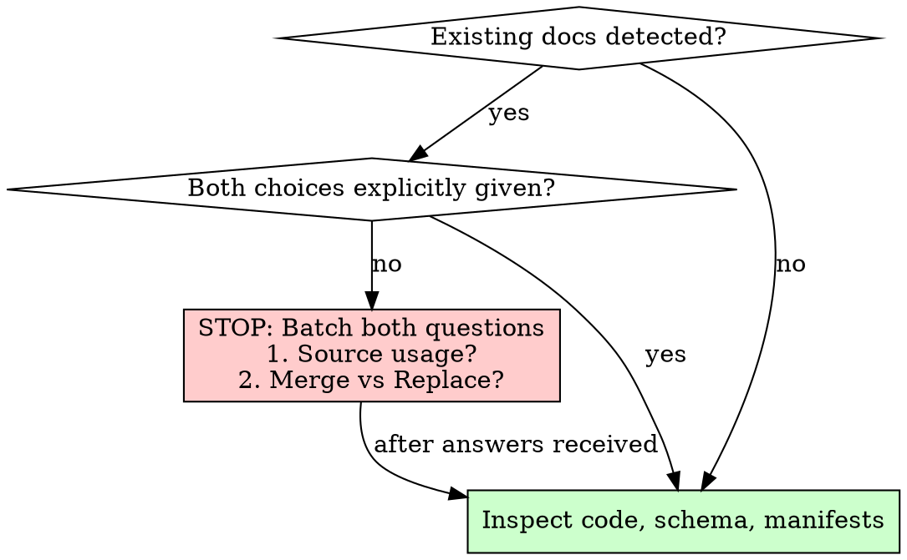

# Documenting Existing Projects

## Overview
Establishes standardized repository documentation from an existing codebase through evidence-based inspection without silently overwriting legacy material or guessing business intent.

## When to Use
- Documenting an existing or inherited repository.
- Reverse-engineering architecture, data models, or feature specifications from code, schema, and tests.
- Establishing repository standards (`AGENTS.md`, `docs/`) for a project that lacks them.

## When NOT to Use
- Creating a brand new, empty, or un-implemented project (use `initializing-project-knowledge`).
- Updating specs for day-to-day feature work or bugfixes (use `working-with-project-specs`).
- Verifying existing documentation against code in a read-only audit (use `auditing-project-knowledge`).

---

## The Two Independent Legacy Choices (Mandatory Gate)

When encountering an existing project with existing documentation, **STOP before reading legacy prose for business meaning or writing any files**.

You must obtain answers to two independent choices. If not already explicitly provided, ask both questions in a single batched prompt:

1. **Legacy Source Choice**: May existing legacy documentation be used as an additional reference source for business rules and intent alongside code and schema?
2. **Write-Mode Choice**: Should new documentation **merge** with existing documentation, or **replace** existing documentation?

### Enforcing the Source Choice
- **Allowed as source**: You may inspect legacy docs. Discrepancies between legacy prose and code must be presented neutrally as conflicts for developer resolution.
- **Excluded (no-source)**: Do NOT read legacy prose to infer business logic. Do NOT cite excluded legacy documents as evidence in specifications. Derive rules strictly from code, database schemas, configuration, and developer answers.

### Enforcing the Write-Mode Choice
- **Merge Mode**:
  - Preserve existing unique operational documents, runbooks, and compliance notes.
  - If `no-source` was chosen, reading legacy files for preservation (e.g. checking whether a file has unique operational notes) **requires explicit developer permission first**, stating the preservation-only purpose.
- **Replace Mode**:
  - Replacement scope is strictly limited to disclosed standard destination paths (`README.md`, `AGENTS.md`, `CLAUDE.md`, and standard `docs/` paths) plus individually disclosed, specifically authorized nonstandard sources being replaced or relocated into the new structure (e.g. migrating `docs/overview.md` or `docs/deploy-manual.md`).
  - **NEVER perform recursive deletion** (`rm -rf docs/` or directory wipes).
  - Any undisclosed, out-of-scope, or unique document (e.g. `docs/compliance/soc2-audit-notes.md`, custom operational playbooks) must remain untouched unless specific authorization is granted.
---

## Execution Workflow

### Phase 1: Fast Inventory & Choice Verification
1. List file trees and identify existing documentation (`README.md`, `docs/`, wiki files, notes).
2. Check if the developer provided both the legacy source choice and write-mode choice.
3. If either choice is missing, ask both questions together. Do not read legacy prose for business meaning yet.

### Phase 2: Grounded Code Discovery
1. Use scoped scouts when supported by the host runtime; otherwise inspect files directly.
2. Read project manifests (`package.json`, `pyproject.toml`, `Cargo.toml`, `go.mod`) to identify language, dependencies, and build commands. Do not copy dependency versions into prose documents.
3. Inspect database schemas, migrations, and ORM models to reconstruct the data model.
4. Trace entrypoints, API routing, and service logic to identify features and boundaries.
5. Inspect automated tests to observe developer test expectations.
   - **Crucial**: Existing tests prove implementation expectations and assertions, NOT approved business intent.
   - Code-derived rules must remain in `draft` status until explicitly approved by the developer.

### Phase 3: Target File Mapping & Scope Disclosure
Present the planned documentation mapping to the developer before writing files:
- Files to create (e.g. `AGENTS.md`, `CLAUDE.md`, `docs/project.md`, `docs/architecture.md`, `docs/data-model.md`, `docs/specs/...`).
- Files to update or merge into (under merge mode).
- Files to replace or relocate (under replace mode: disclosed standard destination paths and individually disclosed, specifically authorized nonstandard sources).
- Files preserved untouched (undisclosed, out-of-scope, or unique operational, compliance, and legacy files).

### Phase 4: Neutral Conflict Presentation
If code, tests, legacy documentation (when allowed as source), or requirements disagree:
- **Do not guess or pick a winner.** Code being newer or tests passing does not constitute business approval.
- Present each conflict with:
  1. Documented rule or legacy statement (file and line reference).
  2. Observed code behavior and test expectations (file and line references).
  3. Risk or behavioral impact.
  4. Specific question/decision needed from the developer.

### Phase 5: Developer Approval Gate
1. Present inferred feature specifications and architectural overview.
2. Mark all business rules and feature specs as `draft`.
3. Obtain explicit developer consent before marking any specification `approved`.
4. If replace mode was selected, obtain explicit authorization for the file replacement mapping.

### Phase 6: Documentation Generation & Verification
1. Author documentation according to the [Project Knowledge Standard](references/project-knowledge-standard.md).
2. **Language Invariant**: All generated documentation files must be in **English**, regardless of the user's prompt language or legacy document language.
3. **Identifier Preservation**: Preserve exact code identifiers, method names, table columns, and error strings.
4. **Thin CLAUDE Entrypoint**: Generate `CLAUDE.md` solely as a relative Markdown link pointing to `AGENTS.md`. Do not duplicate instructions.
5. Verify:
   - Check all relative Markdown links.
   - Check feature ERDs match the shared data model in `docs/data-model.md`.
   - Confirm unapproved specs remain marked `draft`.
   - Ensure no temporary discovery artifacts or `changes/` folders were created.

---

## Rationalization Table & Red Flags

| Rationalization | Reality | Correction |
|---|---|---|
| "I should read the README first to understand the project before asking questions." | Reading legacy prose before the source-choice decision biases discovery and violates developer intent. | Stop. Check file paths only. Ask both legacy choices before reading prose. |
| "User chose merge mode, so I must read all old docs to know what to merge." | In `no-source` mode, reading legacy docs without prior consent risks incorporating unapproved business claims. | Ask permission first: explain that the read is strictly for operational preservation, not business logic. |
| "User said REPLACE docs and clean everything up, so I can wipe `docs/`." | Replacing docs never authorizes blanket directory deletion or deleting undisclosed/unauthorized compliance or ops docs. | Propose a narrow file mapping of standard paths and authorized nonstandard sources to replace/relocate. Leave undisclosed unique files untouched. |
| "Code is newer and unit tests pass, so the code behavior is the approved rule." | Green tests prove code consistency, not business authorization. An implemented bug has green tests. | Present the discrepancy neutrally with evidence from both sources. Await developer decision. |
| "The user asked in another language, so I should write docs in that language." | Project knowledge documentation must be universally portable across agents and tools in English. | Conversational replies follow user language, but generated repository documents are strictly English. |
| "The feature is implemented, so its spec status is `approved`." | Status `approved` reflects developer specification consent, not implementation completion. | Keep status `draft` until explicit developer sign-off. |

## Red Flags - STOP and Ask
- Reading `README.md` or `docs/*.md` prose before legacy choices are answered.
- Citing excluded legacy documentation as evidence in feature specs.
- Overwriting or deleting files outside disclosed standard paths or specifically authorized replacements.
- Marking a feature spec `approved` without explicit developer confirmation.
- Silently resolving a contradiction between code and documentation.
- Generating documentation in a language other than English.

---

## Quick Reference: Two Legacy Choices

| Choice | Option | Meaning & Constraints |
|---|---|---|
| **Legacy Source** | Allowed | Inspect legacy docs; flag conflicts with code neutrally. |
| | Excluded (`no-source`) | Do NOT read or cite legacy docs for business rules. Derive only from code/schema. |
| **Write Mode** | Merge | Preserve existing content; update iteratively; request permission before preservation reads. |
| | Replace | Narrow replacement of disclosed standard paths and authorized nonstandard sources; leave undisclosed unique/ops docs untouched. |

---

## Detailed Standard Reference
See [references/project-knowledge-standard.md](references/project-knowledge-standard.md) for complete file layout, section requirements, and feature spec schemas.
