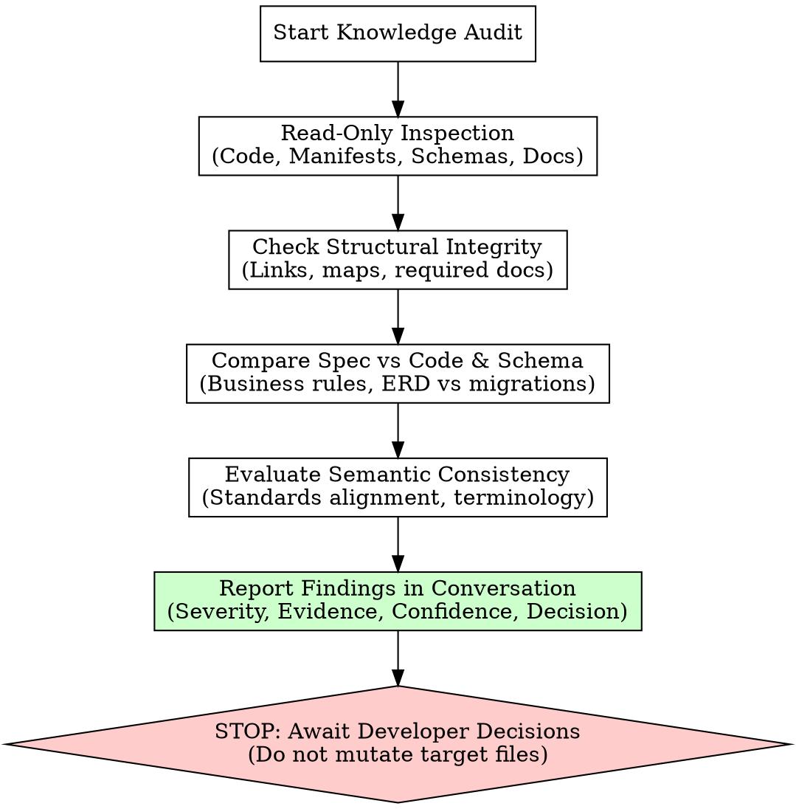

# Auditing Project Knowledge

## Overview

Evaluates repository documentation against code, schemas, and standards in a strictly read-only manner. Delivers structured findings in conversation without mutating target files, creating unrequested audit artifacts, or applying automatic rewrites.



---

## When to Use

- Verifying existing repository documentation against actual code, schemas, and test suites.
- Checking structural integrity: relative Markdown links, implementation/test mappings, and required standard documents.
- Auditing spec-code-schema consistency to identify divergences or stale documentation.
- Evaluating whether standards (e.g. UI vs coding standards) are mutually consistent.
- Pre-release or periodic quality gates for project knowledge bases.

## When NOT to Use

- Documenting an existing repository or generating missing documentation from scratch (use `documenting-existing-projects`).
- Initializing documentation for a greenfield or un-implemented project (use `initializing-project-knowledge`).
- Updating specifications or reconciling approved business rule changes (use `working-with-project-specs`).
- Executing code refactors, bugfixes, or automated doc repairs.

---

## Core Invariants (The Inviolable Laws of Auditing)

```
AN AUDIT IS STRICTLY READ-ONLY.
NEVER MUTATE TARGET FILES. NEVER CREATE UNREQUESTED AUDIT FILES.
```

1. **Zero Target File Mutations**:
   - Never edit, write, or patch any file in the target repository.
   - Pre-existing files must remain 100% byte-identical before and after the audit.
2. **Zero Unrequested Target Artifacts**:
   - Never write audit reports, logs, JSON dumps, or temporary files (`audit-report.md`, `.audit.json`, `changes/`) into the target repository.
   - All findings belong exclusively in the conversation response unless the user explicitly requested a specific file path.
3. **No Automatic Rewrites or Inline "Fixes"**:
   - Refuse to apply "obvious" typo fixes, link repairs, schema adjustments, or spec edits during an audit, even under deadline pressure.
   - An audit discovers and reports; it never silently alters.
4. **No Unilateral Blessing or Approval**:
   - Automated link checks passing does NOT mean documentation is valid or approved.
   - When code contradicts a spec, do not declare code "correct" or spec "correct". Present the divergence neutrally.
   - An audit never marks a spec `approved` or blesses unapproved behavior.
   - **Spec Approval != Implementation Completion**: Spec status `approved` indicates verified developer agreement on business rules, NOT whether code or tests are implemented. A feature spec may legitimately be `approved` for planned or in-progress features where implementation is unimplemented (`Not yet available`) or tests are pending.
   - **Lack of Tests Never Disproves Approval**: Lack of code, missing test suites, or open criteria `[ ]` never disproves real developer spec approval. NEVER recommend reverting an `approved` spec to `draft` solely because tests or code are incomplete. Report missing verification separately as implementation progress.
   - **Unknown Consent is Unknown, Not Missing**: If approval provenance is unrecorded in metadata, report consent as unconfirmed/unknown awaiting verification, not as an asserted defect.
   - **No Target Approval Archive Required**: Never demand an approval log, decision archive, or change trail in the target repository. The standard explicitly forbids per-change approval archives.
5. **Preserve Semantic Uncertainty**:
   - Separate deterministic structural defects from semantic conflicts and unknown intent.
   - Never turn semantic ambiguity or architectural disagreements into asserted code defects without evidence.
---

## Rationalization Table & Red Flags

### Rationalizations to Reject

| Rationalization | Reality | Correct Action |
|---|---|---|
| "Typo fixes and link corrections seem safe to apply now." | Small fixes alter target bytes and can introduce subtle semantic changes. | Report the broken link or typo as a finding; make zero edits. |
| "I'm only changing documentation, not production code." | The read-only audit boundary protects the entire target tree, docs included. | Keep all documentation files byte-identical. |
| "All links pass, so the documentation is completely valid." | Link checkers verify file paths, not business rules or standards consistency. | Inspect spec/code alignment and standards agreement before declaring a verdict. |
| "The deadline is today, so fixing obvious errors saves time." | Rushed automated repairs bypass developer review and destroy audit fidelity. | Deliver findings immediately in conversation so the developer can prioritize. |
| "Code differs from spec, so the spec must be outdated." | Code may contain a severe regression; spec may capture the intended contract. | Present divergence neutrally with evidence from both sources; ask for a decision. |
| "Spec is marked `approved` but has no tests or open criteria, so it should be reverted to `draft`." | Spec approval denotes developer agreement on business rules, not implementation completion. | Keep approved status; report missing tests or open criteria separately under pending verification. |
| "No approval log or decision archive exists in the repo, so approvals are unverified defects." | The project knowledge standard explicitly forbids per-change approval archives or logs in the target repo. | Report unknown consent neutrally as unconfirmed in conversation; do not demand a repo archive. |
| "I should leave an audit report file in the repository." | Dropping unrequested files pollutes the repo and violates repository hygiene. | Present findings in conversation; write a file only if explicitly commanded. |

### Red Flags - STOP Immediately

- Calling `edit`, `write`, or shell commands that modify target files during an audit.
- Creating `audit-report.md` or `.audit-results` inside the target directory without an explicit path requested by the user.
- Issuing a `PASS` verdict based solely on green link checks when standards or specs diverge.
- Changing code or docs to conform to one conflicting standard over another.
- Recommending that an approved spec be reverted to `draft` solely because implementation code or automated tests are missing.
- Demanding a target repository approval log, change archive, or decision directory for spec approvals.
- Asserting developer consent is missing when it is merely unrecorded or unknown.
---

## Three Categories of Audit Findings

Every finding must be categorized into one of three distinct classes:

### 1. Structural Checks (Deterministic)
Verifiable file and path relationships evaluated without subjective interpretation:
- **Applicable document formats and ownership**: At this audit branch, read the affected file recipes in the [Authoring Guide](references/project-knowledge-authoring.md). Check headings/order, conditional omissions, actual project facts, and content ownership, including architecture's Repository Map and development's invocation procedures. Trace task-conditioned links and overlapping-domain selection; reading a recipe authorizes no target writes. Distinguish applicable format defects from unresolved project decisions or irrelevant optional sections.
- **Missing required entrypoints**: Absence of `README.md`, `AGENTS.md`, or `CLAUDE.md`.
- **Missing standard documents**: Absence of `docs/project.md`, `docs/architecture.md`, `docs/development.md`, etc., when required by project state.
- **Broken relative links**: Markdown links targeting non-existent files or anchors.
- **Broken implementation/test links**: Feature spec `Implementation & Test Mapping` linking to missing files or functions.
- **Missing spec sections**: Feature specs missing mandatory headings (`Status & Metadata`, `Business Rules`, `Acceptance Criteria`).

### 2. Observed Code & Schema Divergence (Empirical)
Direct contradictions between documented intent and observable implementation:
- **Spec vs Code**: Approved spec states rule $X$, but code implements behavior $Y$.
- **Data model vs Database**: `docs/data-model.md` defines entity relationship $A \rightarrow B$, but migrations/ORM models define $A \rightarrow C$.
- **Fabricated criteria approval**: Acceptance criteria marked checked `[x]` without executed, passing automated tests (open criteria `[ ]` are expected and valid for pending work).
- **Unapproved rules marked approved**: Spec labeled `approved` despite developer explicitly marking rules draft or withholding approval (crucial: lack of code or tests does NOT mean unapproved; do NOT conflate unimplemented features with unapproved specs).
- **Missing Verification vs Invalid Approval**: Missing implementation or tests for an approved spec is an implementation progress observation, NOT a spec approval defect. Report missing verification separately under implementation progress; never recommend reverting `approved` status to `draft` on that basis.
### 3. Semantic Uncertainty & Standards Conflicts (Interpretive)
Contradictions between different standards or guidelines that cannot be mechanically resolved:
- **Standards collision**: `docs/standards/ui.md` mandates shared component `<Button>`, while `docs/standards/coding.md` mandates native `<button>` elements.
- **Terminology drift**: Feature spec uses domain terms contradicting definitions in `docs/project.md`.
- **Architectural ambiguity**: Documentation describes modular boundaries that are unclear or unenforced in codebase structure.

---

## Finding Output Contract (Conversation Recipe)

Report all findings in conversation using the following structured format:

### Finding Block Format

```markdown
### [FINDING-<CATEGORY>-<NUM>] <Concise Title>
- **Category**: Structural Check | Code & Schema Divergence | Semantic Conflict
- **Severity**: Critical | Major | Minor | Info
- **Source / Rule**: `<file-path>:<line-or-section>` (and standard reference)
- **Evidence**:
  - *Documented*: Quote of documented rule or link path.
  - *Observed*: Quote of code, migration, or filesystem fact.
- **Confidence**: High (Deterministic) | Medium (Empirical Divergence) | Uncertain (Semantic Ambiguity)
- **Required Decision**: Specific choice or clarification needed from developer.
- **Corrective Routing**: Workflow to execute fix (`working-with-project-specs`, `documenting-existing-projects`, or development task).
```

### Audit Summary Verdict

Every audit must end with a clear, honest verdict:
- **`PASS`**: All structural checks pass, zero spec/code divergences detected, zero standards conflicts found.
- **`FAIL`**: One or more deterministic structural errors (broken links, missing docs) or spec/code contradictions observed.
- **`BLOCKED`**: Standards contradict each other or unapproved divergences prevent determining repository compliance without a developer precedence decision.

**CRITICAL**: Passing link checks alone NEVER warrants a `PASS` verdict if semantic conflicts or spec divergences exist.

---

## Workflow Routing for Corrections

An audit identifies issues; it does not fix them. Guide the developer to the appropriate specialized procedure:

1. **For Spec/Code Divergence or Rule Updates**:
   - Direct to `working-with-project-specs`.
   - Used to approve spec changes, reconcile code to spec, or record authorized exceptions.
2. **For Missing Standard Documents or Initial Scaffolding**:
   - Direct to `documenting-existing-projects` (existing code) or `initializing-project-knowledge` (new project).
   - Used to generate missing structure with proper developer gates and legacy choices.
3. **For Code Bugs or Regressions**:
   - Route to regular development/testing workflows to repair code to meet approved specs.

---

## Quick Reference Table

| Audit Area | What to Inspect | Failure Indicators | Category |
|---|---|---|---|
| **Entrypoints** | `README.md`, `AGENTS.md`, `CLAUDE.md` | Missing file, duplicate rules in `CLAUDE.md`, broken navigation | Structural |
| **Links** | All Markdown relative links | 404 target, missing headings, broken implementation paths | Structural |
| **Business Rules** | Feature specs vs implementation code | Spec requires check, code omits it; return values confused with side effects | Divergence |
| **Data Model** | `docs/data-model.md` vs SQL migrations | Discrepant foreign keys, missing tables, inverted relationships | Divergence |
| **Approval State** | Spec metadata vs criteria/tests | Criteria checked `[x]` without test proof; explicit draft labeled approved (missing tests/code != unapproved spec) | Divergence |
| **Standards** | `docs/standards/*.md` | UI standard contradicts coding standard; conflicting styling rules | Semantic Conflict |

See [references/project-knowledge-standard.md](references/project-knowledge-standard.md) for complete specification schemas and required documentation layout.
