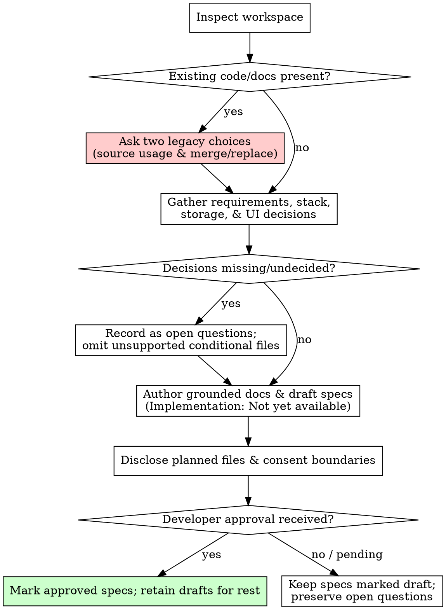

# Initializing Project Knowledge

## Overview
Establishes standardized repository documentation (`AGENTS.md`, `CLAUDE.md`, and modular `docs/`) for a new, unimplemented project from agreed requirements and architecture decisions—without scaffolding applications, inventing unconfirmed schemas, or authorizing unapproved coding.

## When to Use
- Starting a brand new project from requirements, user stories, or product proposals.
- Establishing initial repository documentation and architecture standards before code is written.
- Formulating initial feature specifications and technical standards from agreed requirements.
- Setting up agent navigation rules (`AGENTS.md`, `CLAUDE.md`) in an empty or fresh repository.

## When NOT to Use
- Documenting an existing codebase that already contains code or schemas (use `documenting-existing-projects`).
- Modifying specifications for ongoing feature work or bugfixes (use `working-with-project-specs`).
- Verifying existing documentation against implementation in a read-only pass (use `auditing-project-knowledge`).
- Scaffolding application projects, running framework generator CLIs, or writing application code (this skill produces knowledge documentation only).

---

## Workspace Pre-Check: Existing Documentation or Code

Before creating files, inspect the target repository root:
1. If the repository already contains code, database schemas, or existing documentation (`README.md`, `docs/`, wiki pages):
   - **STOP**.
   - If the codebase is already implemented, redirect to `documenting-existing-projects`.
   - If the developer intends to initialize documentation in a repository with existing documents, ask the two independent legacy choices before reading legacy prose for business meaning or writing files:
     - **Legacy Source Choice**: May existing documentation be used as an additional reference source for requirements?
     - **Write-Mode Choice**: Should new documentation merge with or replace existing documentation?
2. If the repository is fresh or empty, proceed with initialization.

---

## Core Rules & Invariants

### 1. No Application Scaffolding or Code Implementation
- This skill initializes **knowledge documentation only**.
- **NEVER** run application scaffolding commands (`npm create`, `npx create-react-app`, `flutter create`, `cargo init`, `django-admin startproject`, etc.).
- **NEVER** write application source code, mock repositories, UI components, or test files.
- **NEVER** instruct the developer to start coding before specifications and architectures are approved.

### 2. No Fabricated Decisions, Schemas, or Authority Under Pressure
- Under rush pressure ("deadline today", "guess and hurry", "mark approved so coding can begin"), **refuse to fabricate decisions**.
- If persistence or storage engine is undecided, **do NOT invent database tables, columns, UUIDs, foreign keys, or schemas**. Record persistence as an open architectural decision.
- If the tech stack is undecided (e.g. "React or Flutter"), record both as candidate options in `docs/project.md` or `docs/architecture.md`; do NOT arbitrarily pick one as a "provisional default" or write stack-specific standards.
- If the product owner or approver is unassigned, record as unassigned; do NOT assume or fabricate approval.

### 3. Conditional File Discipline
Only create documents supported by explicit developer decisions:
- `docs/data-model.md`: Created **ONLY** when persistent storage and data entities are confirmed. If storage is undecided, omit this file.
- `docs/standards/ui.md`: Created **ONLY** when a user interface is decided. If stack is undecided or pure backend/CLI, omit this file.
- `docs/decisions/`: Created **ONLY** when a durable Architecture Decision Record (ADR) is warranted. Initial architectural rationale belongs in `docs/architecture.md`.
- **NEVER** create empty scaffold files, placeholder directories, or blank templates.

### 4. Grounded UI Standards without Demanding Mockups
When UI conventions have been decided:
- Record agreed shared component APIs (e.g. shared `Button` variants, sizes, states, prop types), design tokens (colors, typography, spacing), styling rules, and accessibility expectations in `docs/standards/ui.md`.
- **Do NOT demand mandatory screen mockups**, wireframes, or full-page designs before establishing UI standards.
- **Distinguish UI standards from feature behavior**: shared component contracts live in `docs/standards/ui.md`; specific user flows (e.g. booking flow, checkout flow) belong in feature specifications under `docs/specs/<domain>/<feature>.md`.
- **Safeguard against Invented UI Defaults & Thresholds**:
  - Unselected UI tokens, responsive breakpoints/thresholds (e.g. 768px, 1024px), token values, and component prop defaults (e.g. `ButtonProps` default variant or size) that were NOT explicitly agreed MUST NOT be recorded as mandatory policy.
  - Any unconfirmed tokens, thresholds, or API defaults must remain explicitly labeled as **proposals** or **unknowns** awaiting developer decision.
  - Approved feature scope or general responsive shape does NOT constitute approval for UI implementation defaults.

### 5. Honest Implementation & Test Mapping
Because the project is not yet implemented, feature specifications must state:
```markdown
## Implementation & Test Mapping
- **Implementation**: Not yet available
- **Tests**: Not yet available
```
**NEVER** invent hypothetical file paths (e.g. `src/domain/types.ts`, `src/features/...`) before they exist in the codebase.

### 6. Specification Approval Boundary
- All initial feature specifications must be marked `Status: draft`.
- Acceptance criteria are open conditions (`- [ ]`). **NEVER** mark them checked `[x]` without observed test execution.
- List all open decisions and dependencies under `## Open Questions`. Material open behavioral questions within scope prevent approved status. Excluded future topics or out-of-scope backlog items do not prevent approval.
- Specifications become `approved` **ONLY** with explicit developer sign-off.

### 7. Language and Portability Invariants
- All generated documentation files (`README.md`, `AGENTS.md`, `CLAUDE.md`, `docs/**/*.md`) must be written in **English**.
- Conversational interaction follows the user's preferred language.
- Code identifiers, domain terms, and token names must be preserved verbatim.
- `CLAUDE.md` must be a minimal relative link to `AGENTS.md` (`[AGENTS.md](./AGENTS.md)`).

---

## Execution Workflow



### Phase 1: Requirement Gathering & Decision Inventory
1. Capture the business purpose, core user problems, and target audience.
2. Inventory confirmed decisions vs undecided questions:
   - **Tech Stack**: Confirmed language/framework or candidate options?
   - **Persistent Storage**: Confirmed database engine or undecided?
   - **UI Foundation**: Reusable components, design tokens, styling rules agreed?
   - **Ownership & Approvers**: Assigned or unassigned?
3. If critical decisions are undecided, do not guess; capture them as open questions.

### Phase 2: Document Scope Determination
Determine the minimal, grounded set of documentation files to produce:
- **Universal Root**: `README.md`, `AGENTS.md`, `CLAUDE.md`.
- **Project & Architecture**: `docs/README.md`, `docs/project.md`, `docs/architecture.md`.
- **Conditional Data Model**: `docs/data-model.md` (only if storage engine and entities are confirmed; otherwise omit).
- **Development**: `docs/development.md` (prerequisites and planned workflows; no invented scaffolding commands).
- **Conditional Standards**:
  - `docs/standards/coding.md` (general conventions confirmed by developer; label unconfirmed as proposals).
  - `docs/standards/testing.md` (testing strategy and planned layers).
  - `docs/standards/ui.md` (only if UI is decided; captures shared components and tokens without requiring mockups).
- **Workflows & Specifications**:
  - `docs/workflows/spec-changes.md`.
  - `docs/specs/README.md`.
  - `docs/specs/<domain>/<feature>.md` for initial features.

### Phase 3: Authoring Grounded Knowledge
1. Author all documents in **English** adhering to the [Project Knowledge Standard](references/project-knowledge-standard.md). Before writing each file, read its recipe in the [Authoring Guide](references/project-knowledge-authoring.md); use the prescribed headings/order with this project's facts and applicable sections only. Read [AGENTS guidance](references/project-knowledge-authoring.md#agentsmd) for conditional routing and [architecture guidance](references/project-knowledge-authoring.md#docsarchitecturemd) for the canonical Repository Map, without inventing implemented structure.
2. For any feature specification:
   - State `Status: draft`.
   - Provide domain glossary and numbered business rules (`BR-<DOMAIN>-<NUM>`).
   - Leave acceptance criteria as open checkboxes (`- [ ]`).
   - State `Implementation: Not yet available` and `Tests: Not yet available`.
   - List unresolved items under `## Open Questions`.
3. In `docs/architecture.md`, document known structural boundaries and explicitly list open technology/storage selections.

### Phase 4: Scope Disclosure & Consent Gate
Present the proposed documentation files and consent boundaries to the developer in conversation:
1. **Confirmed Standards**: Present technical standards (e.g. shared Button API, design tokens) derived from agreed rules.
2. **Draft Specifications**: Present initial feature specifications and architectural options.
3. **Open Decisions**: Explicitly enumerate what requires consent (e.g. persistent storage engine, business flows, approver sign-off).
4. Request developer review and approval. Do not mark specifications `approved` until explicit consent is given.

### Phase 5: Verification
Before completing initialization, verify:
1. **No Scaffolding or Code**: Confirm no application generator CLI commands were run and no source code was written.
2. **Link Integrity**: All relative links resolve to existing files.
3. **Reading Route**: `CLAUDE.md` links to `AGENTS.md`, and `AGENTS.md` routes to `docs/`.
4. **Draft Status**: All unapproved feature specifications remain marked `draft`.
5. **No Empty Scaffolds**: Confirm no blank or placeholder files were created.
6. **English Deliverables**: All documentation files are written in English.

---

## Rationalization Table & Red Flags

| Rationalization | Reality | Correction |
|---|---|---|
| "The user said hurry and guess sensible schema, so I should generate tables now." | Guessing schemas creates phantom constraints and unevidenced architecture. | Omit `docs/data-model.md` when storage is undecided. Record persistence as an open decision in `docs/architecture.md`. |
| "Coding needs to start today, so I will output Vite/React scaffolding commands." | Initializing project knowledge establishes documentation, not code or tool execution. | Do not run scaffolding CLIs or generate application files. Let the developer scaffold the app separately. |
| "I should define provisional file paths like `src/domain/...` so links are complete." | Inventing hypothetical file paths misleads agents into expecting existing source files. | Explicitly state `Implementation: Not yet available` and `Tests: Not yet available`. |
| "We cannot write UI standards without complete screen mockups or visual designs." | UI standards document reusable component contracts, design tokens, and accessibility, not screen layouts. | Document component APIs and tokens in `docs/standards/ui.md` without demanding visual mockups. |
| "The agreed Button and tokens can be implemented right away during initialization." | Knowledge initialization never writes application code or components. | Document the Button and tokens in `docs/standards/ui.md`. Implement components during feature coding. |
| "I should generate a blank `docs/data-model.md` so the documentation structure is complete." | Generating empty files creates noise and violates the standard. | Create conditional files only when supported by confirmed decisions; never generate blank scaffolds. |
| "The user asked in another language, so I should generate the documentation in that language." | Project documentation must be universally portable across agents and tools in English. | Conversational replies follow the user's language, but repository documentation is strictly English. |
| "I can mark the spec approved because the user asked me to start coding." | Implementation requests or rush deadlines do not constitute specification approval. | Keep status `draft` until explicit developer consent is given for the specific business rules. |
| "The project agreed on a shared Button and responsive layout, so I should set 768px breakpoint and default ButtonProps as mandatory standards." | Approved high-level scope or responsive shape does not authorize invented implementation defaults. | Label unselected breakpoints, token values, and prop defaults as proposals/unknowns until explicitly confirmed. |

## Red Flags - STOP and Clarify
- Executing `npm create`, `flutter create`, `cargo init`, or other project scaffolding commands.
- Writing application source code, mock repositories, or UI components.
- Generating `docs/data-model.md` or physical tables when storage is undecided.
- Inventing source file paths (`src/...`) in feature specs before files exist in the repository.
- Marking specifications `approved` without explicit developer confirmation.
- Conflating reusable UI component standards with feature-specific business flows.
- Demanding screen mockups or visual designs before establishing UI standards.
- Creating empty or blank scaffold files.
- Generating documentation in a language other than English.
- Recording unselected UI tokens, responsive breakpoints (e.g. 768px), or component prop defaults as mandatory policy.
- Treating approved feature scope as authorization for invented UI implementation defaults.

---

## Detailed Standard Reference
See [references/project-knowledge-standard.md](references/project-knowledge-standard.md) for complete file layout, section requirements, and feature spec schemas.
