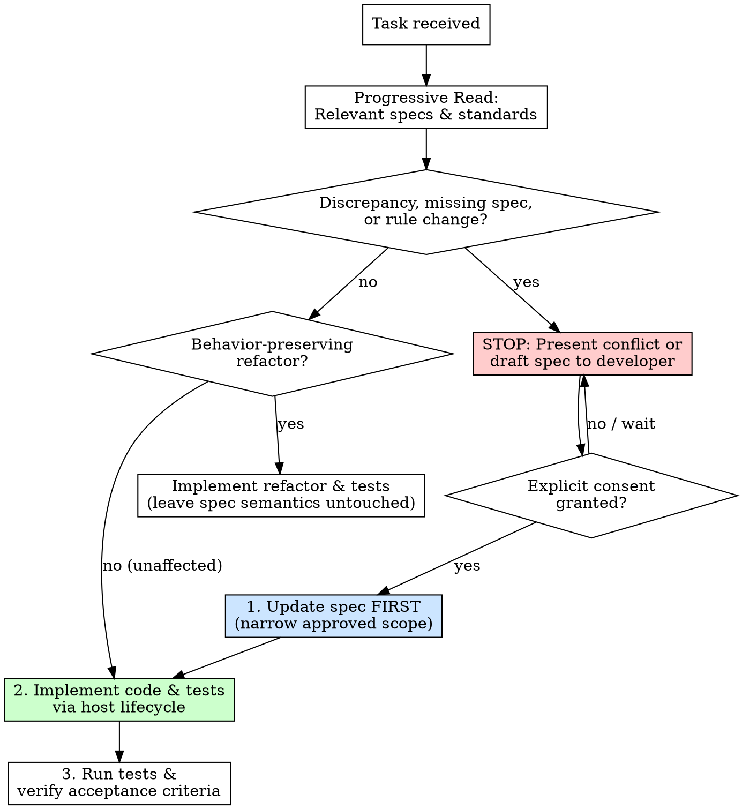

# Working with Project Specs

## Overview

Guides implementation, bugfixes, and refactoring by locating affected specifications and standards before modifying code. Enforces mandatory confirmation stops on missing or conflicting specifications, updates specifications first upon explicit consent, and preserves specification semantics during refactoring while delegating general coding lifecycles to the host environment.

## When to Use

- Implementing a new feature in a repository with an established documentation tree (`docs/specs/`).
- Modifying behavior, fixing bugs, or addressing requirements governed by existing specifications.
- Refactoring code where existing business rules and behavioral semantics must be preserved.
- Encountering code that diverges from approved specification rules or documentation that contradicts code.

## When NOT to Use

- Scaffolding documentation formats or reorganizing selected docs without behavior changes (use `structuring-project-documentation`).
- Initializing documentation for an empty or un-implemented project (use `initializing-project-knowledge`).
- Reverse-engineering and establishing documentation for an existing project from scratch (use `documenting-existing-projects`).
- Performing a read-only audit of documentation integrity and code compliance without modifying code or specs (use `auditing-project-knowledge`).

---

## Core Lifecycle: Spec-First Ongoing Work



---

## Phase 1: Progressive Contextual Reading

Do not read or force-load the entire repository documentation. Read only the documents directly relevant to the current task:

1. **Feature Specification**: Read `docs/specs/<domain>/<feature>.md` governing the affected behavior.
2. **Engineering Standards**: Read relevant standards:
   - `docs/standards/coding.md` for conventions, naming, and error-handling patterns.
   - `docs/standards/testing.md` for test strategies, fixture rules, and assertion styles.
   - `docs/standards/ui.md` if user interface components, styling, or accessibility are affected.
3. **Data Model**: Read `docs/data-model.md` if persistent schemas or cross-domain entity relationships are touched.

---

## Phase 2: Confirmation & Discrepancy Gate (Mandatory Stop)

When existing code diverges from an approved specification, when a specification is missing or ambiguous, or when a user request contradicts an approved business rule:

### 1. Mandatory Stop for Affected Work
- **Halt Implementation**: If the request touches, depends on, or alters code governed by the disputed or missing rule, **STOP immediately**.
- **Do NOT Choose a Winner**: Never treat passing tests or existing code as proof that the specification is wrong. Never treat documentation as infallible without confirming whether code represents an intentional operational exception.
- **Do NOT Silently Mutate**: Do not alter code behavior or edit specification files before the developer makes a decision.

### 2. Neutral Conflict Presentation Formula
Present the discrepancy to the developer using this five-part structure:
1. **Approved Rule Statement**: Exact documented rule, source file, line reference, and rule ID (e.g. `BR-ADDON-001` in `docs/specs/billing/addon-purchase.md:24`).
2. **Observed Code Behavior**: Actual implementation and test behavior, source file, and line reference (e.g. `src/billing/addon.py:42`).
3. **Discrepancy Impact**: Concrete operational or business risks resulting from the divergence.
4. **Material Open Questions**: Specific ambiguities requiring clarification.
5. **Required Decision**: The explicit choice needed from the developer.

### 3. Handling Unaffected Work
If the user request contains independent, unaffected tasks (e.g. renaming an unrelated receipt label or updating copy):
- You may proceed with the unaffected task without blocking.
- You must still neutrally flag the background discrepancy in your response.
- Do NOT modify any code or tests related to the disputed business rule.

---

## Phase 3: Handling Approved Spec Changes

Once the developer gives explicit consent for a specification change:

### 1. Mutation Order: Spec-First
Always update the specification file **FIRST**, before writing implementation code or modifying tests:
```text
Step 1: Edit docs/specs/<domain>/<feature>.md for the authorized behavior change.
Step 2: Implement code and automated tests following host practices.
Step 3: Run test suite to verify acceptance criteria.
```

### 2. Strict Scope Discipline
Apply strictly the approved delta. Do NOT expand scope into neighboring rules, policies, or architecture:
- If developer approves removing subscription requirements for *addon purchase*, do **NOT** remove subscription requirements for *addon use* or change *addon pricing*.
- Keep all unapproved rules, constraints, and side effects strictly intact.

### 3. Specification Update Protocol
When updating the feature spec (`docs/specs/<domain>/<feature>.md`):
- Before authoring, read the [feature-spec recipe](references/project-knowledge-authoring.md#feature-specifications) and its linked standard schema. A spec-only change needs that recipe, not the entire guide; if other documents are affected, consult their recipes as well. Keep generated project links self-contained and update the local spec index when selection scope changes.
- **Business Rules**: Update the specific rule (e.g. `BR-ADDON-001`) with clear, grounded wording.
- **Acceptance Criteria**: Format updated criteria as open conditions (`- [ ]`). Never mark criteria as checked (`- [x]`) until automated tests have been run and verified.
- **Data Model & Persistence**: Update the feature's ERD view if entity attributes or relationships changed. If repository-wide schema changes occurred, update `docs/data-model.md`.
- **Implementation & Test Mapping**: Verify and update links to real codebase files (`src/...`, `tests/...`).
- **No Change Archives**: Never create a `changes/` directory, proposal folder, or approval log. Updates belong directly in the authoritative spec files.

---

## Phase 4: Missing Specs vs. Behavior-Preserving Refactors

### Case A: Missing Specification (New Feature or Unspecified Behavior)
When requested to build a new feature or behavior where no specification exists:
- **Do NOT Skip Straight to Code**: Do not assume business rules from copyable code patterns or vague user phrases like "you know the flow."
- Read the [feature-spec recipe](references/project-knowledge-authoring.md#feature-specifications) and authoritative schema before drafting; use project evidence and explicit unknowns, not generic business rules.
- **Author a Durable Draft Spec**: Create `docs/specs/<domain>/<feature>.md` immediately with:
  - Purpose & Scope
  - Domain Glossary
  - Numbered Business Rules (`BR-[DOMAIN]-[001]`)
  - Flows & Data Access
  - Acceptance Criteria (`- [ ]`)
  - Implementation & Test Mapping: `Not yet available.`
  - Open Questions: Material business questions requiring developer answers.
- **Placement**: Write directly into `docs/specs/<domain>/<feature>.md` using the shared metadata format. Never create proposal folders (`docs/proposals/` or `changes/`).
- **Behavioral Decisions**: Generate the specification without administrative sign-off. Resolve material open questions before implementing affected code; use explicit requirements already supplied.

### Case B: Behavior-Preserving Refactor
When refactoring code without changing observable business logic (e.g. extracting helper functions, optimizing database queries, improving readability):
- **Preserve Spec Semantics**: Do NOT rewrite or alter business rules, flows, or acceptance criteria in `docs/specs/`.
- **Mapping Updates Only**: Update `Implementation & Test Mapping` only if primary file paths or exported entrypoints were relocated or renamed.

---

## Phase 5: Delegation to Host Lifecycle

Do not create or impose an artificial second general coding lifecycle. Delegate routine implementation conventions to the project and runtime:
- **Coding Conventions**: Adhere to `docs/standards/coding.md` and repository linter/formatter configurations.
- **Testing Practices**: Follow `docs/standards/testing.md` and project test runners (e.g. pytest, vitest, cargo test).
- **Development Workflow**: Use the runtime's existing git, branch management, and code review practices.

---

## Common Rationalizations (Table)

| Rationalization | Reality | Correct Action |
|---|---|---|
| "The code works and passes tests, so the spec must be outdated." | Code proves implementation behavior, not approved business intent. | Present discrepancy neutrally and STOP for developer decision. |
| "The user asked me to implement it immediately, so approval is implied." | User prompts express feature requests, not specification consent. | Halt affected code changes; obtain explicit approval for spec delta. |
| "I'll write the code first to explore, then update the spec after." | Code-first mutation leads to unapproved rule drift and missed edge cases. | Update spec FIRST, then implement code. |
| "While I'm changing purchase eligibility, I might as well update usage rules." | Scope expansion violates developer authorization. | Confine edits strictly to the approved delta. |
| "A refactor needs a manual spec freshness update." | Git records edits; an unchanged behavioral contract needs no metadata chore. | Update mappings only when their targets move; preserve unchanged spec content. |
| "No spec exists, but existing code patterns make the business flow obvious." | Code patterns show how to build, not intended business behavior. | Generate the specification from supplied requirements, recording questions; resolve affected unknowns before implementation. |

---

## Red Flags - STOP and Check

- Modifying implementation code before updating the corresponding specification file.
- Implementing a new feature without a durable specification in `docs/specs/`.
- Modifying disputed code while waiting for developer conflict resolution.
- Expanding approved scope into neighboring rules, pricing, or entitlements.
- Creating temporary `changes/`, proposal directories, or approval log files.
- Marking acceptance criteria checked (`[x]`) before tests are run and verified.

---

## Quick Reference

| Situation | Action | Spec Content | Code Action |
|---|---|---|---|
| **Spec & Code Disagree (affected task)** | STOP; present conflict neutrally | Preserve disputed requirements | No affected code modifications |
| **Spec & Code Disagree (unaffected task)** | Flag conflict; perform unaffected task | Preserve disputed requirements | Modify only unaffected code |
| **Decided Behavior Change** | Update spec FIRST; then implement | Record the authorized delta | Implement strictly authorized delta |
| **New Feature / Missing Spec** | Generate spec; record questions | Automatic metadata, explicit known behavior | Implement once material affected behavior is settled |
| **Behavior-Preserving Refactor** | Refactor code; update tests | Update only relocated mappings | Preserve behavior |

See [references/project-knowledge-standard.md](references/project-knowledge-standard.md) for complete specification schema and standards.
